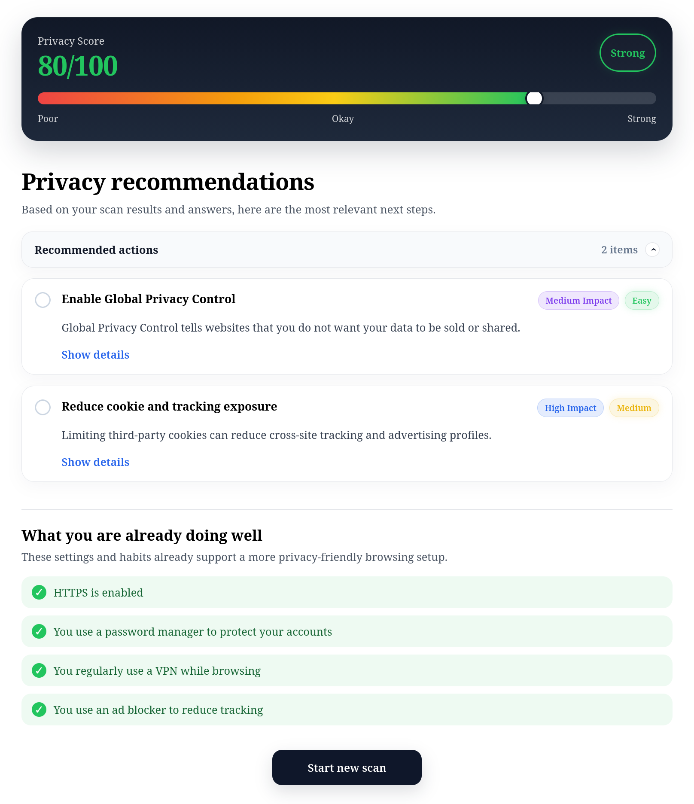

# Privacy Coach

Privacy Coach is a browser privacy assessment tool that helps users understand and improve their privacy while browsing the web.

The application analyzes privacy-related browser signals locally, asks adaptive follow-up questions, calculates a privacy score, and provides personalized recommendations.

This project was developed as a capstone project at CODE University.

## Screenshot



## Features

- Browser and operating system detection
- Cookie and Global Privacy Control detection
- Fingerprinting exposure analysis
- Adaptive follow-up questions
- Privacy scoring system
- Personalized privacy recommendations
- Fully client-side analysis

## How It Works

1. Analyze privacy-related browser signals locally.
2. Answer adaptive follow-up questions.
3. Review your privacy score and personalized recommendations.

## Installation

```sh
npm install
npm run dev
```

## Usage

After completing the installation steps, open the application in your browser and follow the guided privacy assessment.

## Tech Stack

### Frontend
- Vue 3
- TypeScript
- Pinia

### Testing
- Vitest
- Playwright
- Selenium

### DevOps
- Docker
- GitHub Actions

## Documentation

Detailed project documentation can be found in the [docs](docs/README.md) directory, including architecture, testing, CI/CD, and deployment documentation.

## License

This project is licensed under the GNU GPLv3 License.
